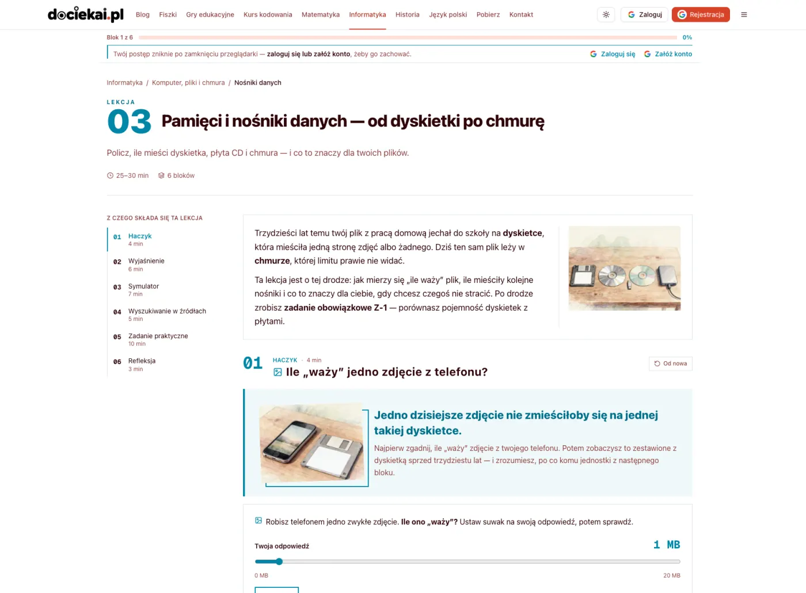
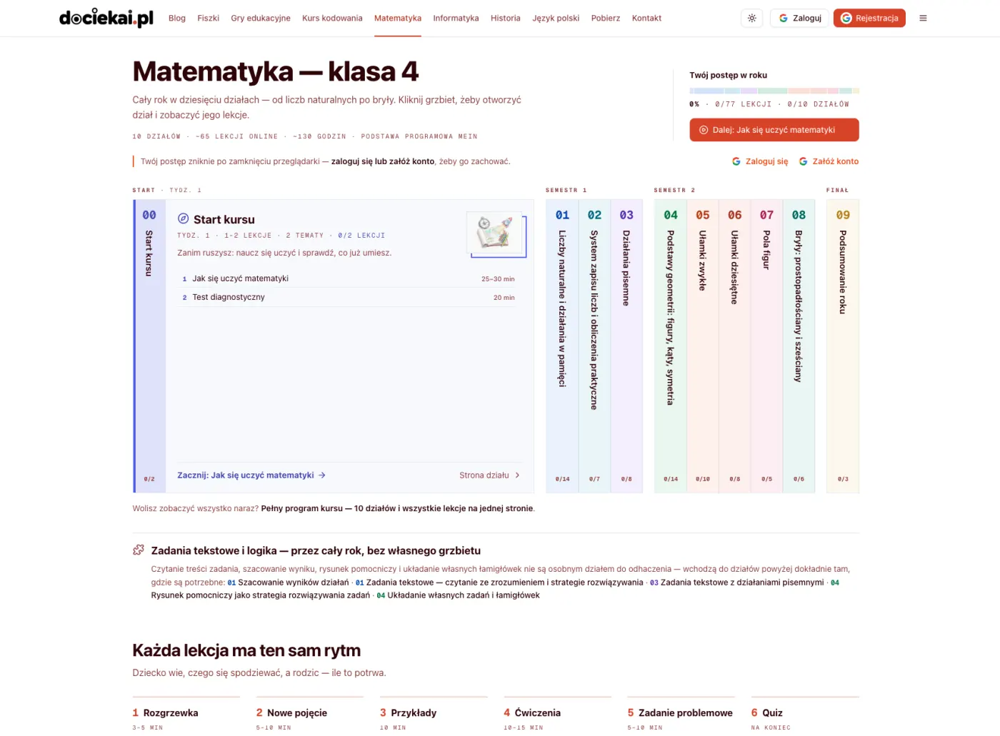
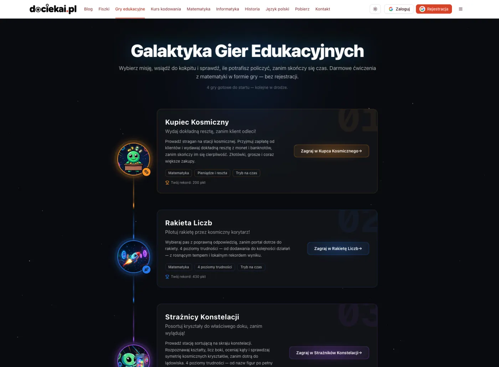
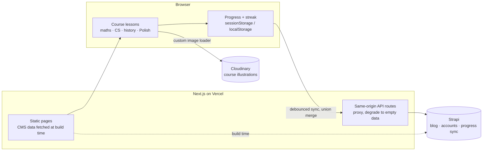
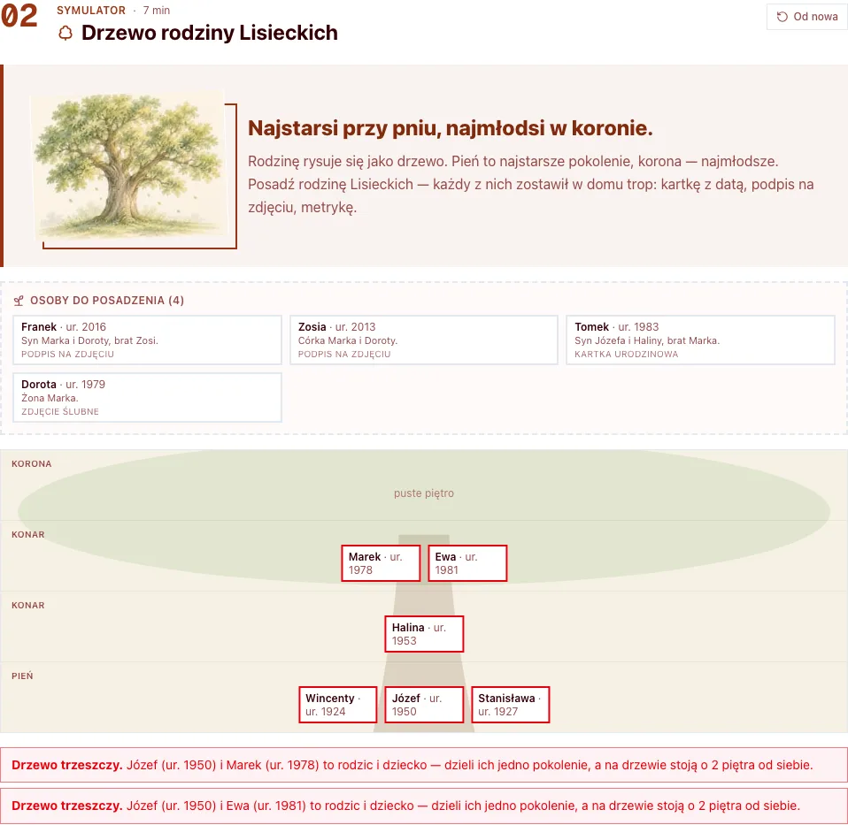
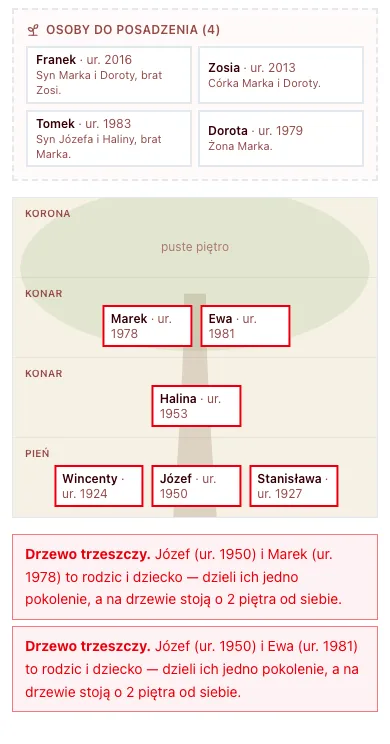

# DociekAI

[](https://github.com/g-krzysztof/dociekai/actions/workflows/ci.yml)

**A Next.js 16 / React 19 / TypeScript product in production, designed, built and run by one developer: four courses, 166 interactive lessons and 16 guides.**

An interactive learning platform for Polish primary-school children (grade 4, age ~10): full courses in maths, computer science, history and Polish, where every exercise is something the child *does* on the page and the page itself checks.

**Live:** [dociekai.pl](https://dociekai.pl) · the UI and content are in Polish

> **Curated snapshot.** This is a public extract of a private codebase. The backend, internal planning documents and git history are left out on purpose; see [About this repository](#about-this-repository).

Designed, built and run solo by **Krzysztof Gryc**, a React / TypeScript developer. I'm looking for a senior frontend role: [hello@krzysztofg.pl](mailto:hello@krzysztofg.pl) · [LinkedIn](https://www.linkedin.com/in/krzysztof-gryc/) · [krzysztofg.pl](https://krzysztofg.pl)



| | |
| --- | --- |
|  |  |
| **Course hub**: the year as a bookshelf, one spine per module | **Educational games**: timed maths practice, personal bests kept on the device |

## What's in it

| Course | Status (November 2026) |
| --- | --- |
| Maths, grade 4 | 77 lessons and 16 interactive guides |
| Computer science, grade 4 | complete, 38 lessons |
| History, grade 4 | complete, 33 lessons |
| Polish, grade 4 | in progress, 18 of 48 lessons |

Plus: educational mini-games, printable cheat sheets and flashcards (PDF), a cross-course daily learning streak with badges, user accounts with progress sync, a blog served from a headless CMS.

Every lesson works fully as a guest. An account adds sync across devices and the streak.

**Stack:** Next.js 16 (App Router, React Server Components) · React 19 · TypeScript (strict) · Tailwind CSS 4 · Radix UI / shadcn/ui · Framer Motion · Playwright · esbuild · GitHub Actions · Strapi (headless CMS) · Cloudinary · Vercel

## About this repository

This is a curated public snapshot of a private codebase, published as a portfolio piece. Development continues in the private repository, and this one is refreshed with periodic snapshots. What you see builds, type-checks, passes its tests and runs locally with no backend at all.

**Code comments and domain names are in Polish**, the language of the curriculum and of the people who use the product: a lesson about *ułamki* is called `ulamki`, not `fractions`. The shared, architecture-level code ([src/lib/](src/lib/), [src/components/block-lesson/](src/components/block-lesson/)) is the easiest place to start reading; the [Engineering highlights](#engineering-highlights) below point into it.

**Left out on purpose:**

- **The backend:** a Strapi instance that serves the blog, user accounts and progress sync. The frontend reaches them only through Next.js API routes, and the contracts it expects are documented in [docs/](docs/).
- **Content-production tooling:** the image and audio generation pipelines used to illustrate and narrate lessons. The small data-prep scripts that remain in [scripts/](scripts/) (map outlines from Natural Earth, image normalisation, corpus annotation) only produce data files that are committed alongside the code.
- **Internal working documents:** curriculum plans, per-lesson design notes, progress logs and the instruction files for the AI coding agents (see [How it's built](#how-its-built)).
- **Part of the media:** course illustrations live on a CDN and are referenced by key, see [Cost-aware media](#engineering-highlights).
- **Git history:** the snapshot is published as a single commit. The private history mixes code with the internal documents above.

## Architecture at a glance



Every lesson runs fully in the browser; the backend only adds accounts and sync.

## Engineering highlights

Where I'd point a reviewer first:

- **Derived state instead of stored aggregates: the learning streak** ([src/lib/streak/](src/lib/streak/)). Storage keeps only raw `date → lessons[]`. Streak, record, weekly "freezes" and all 24 badges are recomputed by pure functions ([derive.ts](src/lib/streak/derive.ts), [badges.ts](src/lib/streak/badges.ts)). The streak counts *school days*, so weekends, national holidays and school breaks are skipped ([school-calendar.ts](src/lib/streak/school-calendar.ts)). Dates are local, never UTC. Sync merges by **union of days**: the merge is commutative and nothing gets lost, whatever order the devices sync in.
- **Guest-first progress with merge on sign-up** ([src/lib/course-progress/](src/lib/course-progress/)). Guests keep progress in `sessionStorage`. On sign-up, the session is merged into the account. Sync is debounced and best-effort: a network error never blocks learning, and logout flushes pending changes before clearing them. One implementation serves all four courses.
- **A shared lesson engine** ([src/components/block-lesson/](src/components/block-lesson/)). Lessons are composed from blocks on a common shell, which handles progress, completion and streak recording. The CS, history and Polish courses run on it; maths, the oldest course, keeps its own step-based shell on the same progress and streak modules. Each course supplies only its own blocks and widgets: drag-and-drop on a shared pointer-events hook with a tap-to-place fallback ([use-drag-token.tsx](src/components/block-lesson/use-drag-token.tsx)), maps, a spreadsheet with a formula parser and a document model for the CS course, and more.
- **Server/client split and hydration-safe browser state.** Server components fetch data and seed it into context; interactivity lives in co-located `*-client.tsx` components. Newer code reads state that lives outside React (storage, media queries) through `useSyncExternalStore` ([use-media-query.ts](src/components/ui/use-media-query.ts), [teczka.ts](src/app/materialy/lib/teczka.ts)), so the server render and hydration agree and no effect has to copy it into `useState`. Older code still does the latter; see [Known limitations](#known-limitations).
- **Answer checkers as pure, tested functions.** The logic that judges a child's answer lives outside React. `npm run test:unit` bundles it with esbuild and runs **55 suites of assertions** ([scripts/\*-selftest.mjs](scripts/)), covering edge cases like DST, year boundaries and ambiguous answers that would be impractical to click through.
- **Static-first, resilient CMS integration.** CMS data is fetched at build time and seeded into context, then refreshed on the client ([build-time-data.ts](src/lib/build-time-data.ts), [app-context.tsx](src/components/app-context.tsx)). The browser only talks to same-origin API routes ([src/app/api/](src/app/api/)), which proxy to the CMS and auth backend and degrade to empty data instead of failing the page.
- **Cost-aware media.** Vercel's image optimizer is bypassed with a custom loader ([src/lib/media/loader.ts](src/lib/media/loader.ts)) that rewrites to Cloudinary transformations: per-transformation billing and periodic re-transforms of local images were eating the quota. Images are referenced by stable keys with a local fallback, and a pre-commit hook ([.githooks/pre-commit](.githooks/pre-commit)) blocks oversized binaries from entering the repo.

## One lesson, end to end

To see how the pieces fit together, follow one task: in history lesson 5 the child seats an invented family on the shelves of a family tree, one shelf per generation.

<table>
  <tr>
    <td width="62%"></td>
    <td width="38%"></td>
  </tr>
</table>

*The task as the child sees it, after placing Józef on the wrong shelf. The tree never says "wrong"; it names the two people who contradict each other and gives their years. Left: desktop. Right: a 390 px phone, where the tray and the shelves still fit on one screen.*

1. **Data:** [rodzina-lisieckich.ts](src/app/historia/klasa-4/components/lessons/historia-mojej-rodziny/rodzina-lisieckich.ts) lists the people with their birth years and parents. There is no answer key.
2. **Checker:** [tree-judge.ts](src/app/historia/klasa-4/components/family-tree/tree-judge.ts) is a pure function. It derives the correct shelves from two rules (a child stands one shelf above its parents, spouses share a shelf). Instead of revealing the right answer, it names the two people who contradict each other.
3. **Self-test:** [historia-l5-selftest.mjs](scripts/historia-l5-selftest.mjs) bundles the checker with esbuild and asserts against it, with no React and no browser.
4. **Widget:** [family-tree.tsx](src/app/historia/klasa-4/components/family-tree/family-tree.tsx) handles only rendering and interaction, on the shared drag hook.
5. **Lesson:** [historia-mojej-rodziny-lesson.tsx](src/app/historia/klasa-4/components/lessons/historia-mojej-rodziny/historia-mojej-rodziny-lesson.tsx) is a list of blocks handed to the course shell ([lesson-shell.tsx](src/app/historia/klasa-4/components/lesson-shell.tsx) → [block-lesson-shell.tsx](src/components/block-lesson/block-lesson-shell.tsx)), which owns progress, completion and the streak.

Lesson 24 reuses the same engine with different data, for the family of the Greek gods ([olimp.ts](src/app/historia/klasa-4/components/lessons/bogowie-i-mity/olimp.ts)). There are no birth years there, so the shelves follow from kinship alone.

## How it's built

DociekAI is a one-person product. I build it by treating AI coding agents (Claude Code) as the implementation workforce and working as their tech lead: deciding what gets built and how, and owning what ships.

**What stays with me:**

- **Product, UX and architecture:** the data models, the guest-to-account flow, the sync and merge strategy, the lesson engine, the media and hosting cost decisions.
- **The parts where a subtle bug costs the most:** state that persists and syncs, and the logic that tells a ten-year-old whether they got it right.
- **The conventions and the review.** Agents get small, bounded tasks with written conventions, a reference implementation and an explicit definition of done. Nothing lands without passing typecheck, lint and the self-tests, and I review every change before it does: line by line where persisted state, sync or an answer checker is involved, against the definition of done for lesson content and layout.

**The guardrails** are the ones that would let a team scale: strict TypeScript, pure checkers with self-tests that must pass, Playwright on desktop and mobile, CI on every push, and shared lesson shells, so a new lesson only adds widgets and checkers.

The agents write a large share of the lines; the decisions described in [Engineering highlights](#engineering-highlights) are mine, and I can walk through any of them in detail.

## Known limitations

Things I'd tackle next, or do differently with hindsight:

- **E2E coverage is thin.** Besides a few smoke tests of older features, one spec ([lekcja-postep.spec.ts](tests/lekcja-postep.spec.ts)) covers lesson progress: a guest's progress restoring after reload and dying with the tab, the finished-lesson card, and the merge into the account on login. It seeds progress in storage instead of solving the widgets in a browser. Most correctness lives in the checker self-tests, and the lesson widgets themselves deserve component tests.
- **Drag tasks are not fully keyboard-operable.** Most drag widgets share one hook ([use-drag-token.tsx](src/components/block-lesson/use-drag-token.tsx)) with a tap-to-place fallback, and a token can be picked up with Enter or Space. However, most drop targets are clickable elements that can't take focus, and a handful of custom widgets (a ruler, a resize handle, drawing a path) are pointer-only. For the shared hook the fix lives in one place: give targets a role, a tab stop and a key handler.
- **Some lesson widgets are too large.** A few interactive components are close to 1,000 lines, mixing interaction state, rendering and copy. They'd benefit from a split into a reducer, a view and a content file.
- **React Compiler lint rules are warnings for now.** `eslint-config-next` 16 brings the new `react-hooks` rules, which flag about 200 places written before them, mostly `setState` called inside an effect. They're set to `warn` in [eslint.config.mjs](eslint.config.mjs) while I migrate the code gradually. Lint passes in CI with zero errors.
- **Legacy corners.** The older flashcards feature (route `/fishcards`) has unfinished mobile filters, and `react-quiz-kit` pulls in Redux, which is why a small runtime shim exists ([reactReduxShim.ts](src/lib/reactReduxShim.ts)).
- **The auth token lives in `localStorage`.** The JWT is readable by any script on the page, so an XSS bug would expose it. Two things limit that today: blog HTML from the CMS, the one place that renders markup with `dangerouslySetInnerHTML`, is sanitised on the server ([sanitize-blog-html.ts](src/lib/sanitize-blog-html.ts), with its own self-test), and every read and write of the token goes through one module ([auth-token.ts](src/lib/auth-token.ts)). The proper fix is an `httpOnly` cookie set by the same-origin API routes that already proxy every authenticated call; the single module keeps that migration small.
- **Winter breaks in the streak.** They differ per voivodeship and year, so they aren't built in. The data model and sync already support user-set breaks, but there is no UI for them yet.

## Running locally

Requires Node.js 22 and npm.

```bash
npm ci
npm run dev          # http://localhost:3011
```

No configuration is needed: without a backend every lesson runs in guest mode, while the blog and accounts stay empty. To connect a compatible Strapi instance, copy `.env.example` to `.env.local` and set `STRAPI_API_URL`.

## Checks

```bash
npm run typecheck    # tsc --noEmit
npm run lint         # ESLint
npm run test:unit    # 55 self-test suites for lesson logic, the streak and the blog sanitizer
npm run test:e2e     # Playwright, desktop + mobile; starts the dev server itself
```

Before the first E2E run, install the browsers with `npx playwright install`. All four run in CI on every push ([.github/workflows/ci.yml](.github/workflows/ci.yml)), no secrets required.

## A note on language

The product is Polish, and so are the code comments: they explain the *why* behind domain rules (school calendars, how a child's answer is judged) and were written for the people working on the product. Some of them point to internal plans that aren't published here, such as build-stage codes like `E4b` or the name of the image model used for illustrations. Identifiers and this README are in English; routes and lesson folders keep their Polish names, because they are the site's URLs.

## Stack

Next.js 16 (App Router) · React 19 · TypeScript · Tailwind CSS 4 · Radix UI / shadcn · Framer Motion · Playwright · esbuild · Strapi (headless CMS) · Cloudinary · Vercel

## License

This repository is public as a portfolio piece only. It is **not open source**: all rights are reserved, and no permission is granted to copy, modify, redistribute or use the code or content. See [LICENSE](LICENSE). Third-party libraries and assets remain under their own licenses.
